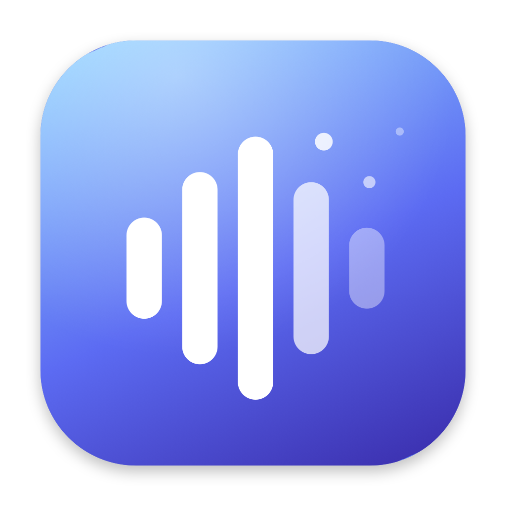

<div align="center">



# WisprLite

**Hold a key, speak, release. Your words appear in whatever app you're using.**

A small, native push-to-talk dictation tool for macOS. It runs as a menu-bar agent with no window and no Dock icon, and it doesn't bundle a speech model.


</div>

---

## Why WisprLite

Many dictation apps are large desktop programs with a heavy interface and a big memory footprint. WisprLite does one job: it turns speech into text in any app.

- **Lightweight.** It's a single native Swift binary. The audio engine exists only while you're recording, so idle cost is close to zero.
- **Works everywhere.** The text is pasted into the focused app: editors, browsers, chat, email, terminals.
- **Accurate first.** It transcribes what you said and doesn't rewrite it. Cleanup only fixes punctuation, capitalization and filler words.
- **Free to run.** It uses Groq's hosted models on the free tier, so there's nothing to download or pay for.
- **No dependencies.** It uses Apple frameworks only, with no third-party packages.

## Features

- **Push-to-talk or hands-free.** Hold the hotkey and release to paste. Double-tap to lock recording on, then tap once more to stop.
- **Configurable hotkey.** Pick a preset (Right Option, Right Command, Right Control, Fn, F5, F6) or record any other key.
- **Light AI cleanup.** Adds punctuation and removes "um", "uh", false starts and repeated words. It never adds, paraphrases or summarizes. You can turn it off.
- **Custom vocabulary.** Add names and technical terms to a text file so they're spelled correctly.
- **Safe paste.** Your clipboard is saved and restored after pasting. If no text field has focus, a result card with a Copy button is shown instead.
- **Silence protection.** Silent or near-silent recordings aren't sent, which avoids the "Thank you." hallucination Whisper produces on empty audio.
- **Floating pill and sounds.** A small overlay and start/stop sounds show recording state. The pill can be hidden.
- **Dashboard.** Words per minute, total words, a streak heatmap and a searchable history of past dictations.
- **Private by design.** Your API key is stored in the macOS Keychain. History stays on your machine.

## How it works

```
Hotkey  →  Record mic  →  Groq Whisper (speech to text)  →  Groq Llama (cleanup)  →  Paste into focused app
```

1. A listen-only global event tap watches for your hotkey.
2. The microphone is recorded as 16 kHz mono audio and kept in memory.
3. The audio is sent to Groq's `whisper-large-v3` for transcription.
4. The text goes to `llama-3.1-8b-instant` with a strict cleanup prompt. If cleanup fails, the raw transcript is pasted instead.
5. The result is pasted with a synthesized Cmd+V.

## Requirements

- macOS 14 (Sonoma) or later, Apple Silicon or Intel
- Swift toolchain (Xcode or Command Line Tools) to build from source
- A free [Groq API key](https://console.groq.com)
- An internet connection

## Install

WisprLite is built from source. There's no prebuilt release yet.

```bash
git clone https://github.com/Prashantvis12527/Wispar_lite.git
cd Wispar_lite
./build.sh
open WisprLite.app
```

Always launch the `.app` with `open` or by double-clicking it. Running the binary inside `Contents/MacOS` makes macOS attribute the permissions to Terminal instead.

### Code signing

`build.sh` signs the app with a local self-signed certificate named **WisprLite Local**. macOS ties permissions to the code signature, so a stable identity stops it from asking for permissions again after every rebuild. If the certificate isn't in your login Keychain, the script falls back to ad-hoc signing and the permissions will reset on each rebuild. See [`CLAUDE.md`](CLAUDE.md) for how to create the certificate.

## Setup

1. Launch the app. A menu-bar icon appears.
2. Paste your Groq API key when prompted. You can change it later from the menu: **Set Groq API key…**
3. Grant the three permissions macOS asks for:

   | Permission | Why it's needed |
   |---|---|
   | **Microphone** | To record your voice |
   | **Accessibility** | To send the paste keystroke and detect the focused field |
   | **Input Monitoring** | To detect the global hotkey |

## Usage

| Action | Result |
|---|---|
| Hold the hotkey (≥ 0.35 s), speak, release | Text is pasted |
| Double-tap the hotkey, speak, tap once more | Hands-free dictation, text is pasted |
| Single quick tap | Ignored, and the recording is discarded |

The default hotkey is **Right Option**. Change it from the menu bar under **Hotkey**.

### Custom vocabulary

Rare words, product names and acronyms are easy for speech models to mishear. List them in `~/.wisprlite/vocabulary.txt`, one per line, or open the file from the menu with **Edit vocabulary…**. The file is re-read on every dictation, so there's no need to restart.

## Privacy

- Your recorded audio and the transcript are sent to Groq to be processed. Review [Groq's data and retention terms](https://groq.com/privacy-policy/) before using it with sensitive content.
- Your API key is kept in the macOS Keychain and is never written to disk files or logs.
- History is stored locally at `~/.wisprlite/history.jsonl`. You can delete entries from the dashboard.
- There is no analytics or telemetry.

## Troubleshooting

| Problem | Fix |
|---|---|
| The hotkey does nothing | Grant **Input Monitoring** and relaunch the app |
| Nothing is pasted | Grant **Accessibility**. If no text field is focused, use the result card's Copy button. |
| Every dictation says "Thank you." | Silent audio is reaching Whisper. Check microphone permission and the input device. |
| Permissions keep resetting | The app was ad-hoc signed. Create the `WisprLite Local` certificate, then run `tccutil reset All com.prashant.wisprlite`, relaunch and re-grant. |
| "Groq rate limit hit" | You've reached the free-tier limit. Wait for it to reset or use another key. |
| A model error from Groq | Model names change over time. Update the constants at the top of `Sources/WisprLite/Groq.swift`. |

Logs are in `~/Library/Logs/WisprLite/log.txt`, and the latest recording is saved as `last.wav` in the same folder. Comparing the RAW and CLEANED lines in the log shows whether Whisper or the cleanup step caused a bad result.

## Project structure

```
Sources/WisprLite/
  main.swift       App delegate, menu bar, permissions, orchestration
  Hotkey.swift     Global hotkey with hold and double-tap detection
  Recorder.swift   Microphone capture to 16 kHz mono WAV
  Groq.swift       Whisper and Llama requests, vocabulary
  Paster.swift     Paste-target check, clipboard-safe paste
  Overlay.swift    Floating pill and result card
  Sounds.swift     Start and stop sounds
  Keychain.swift   API key storage
  History.swift    Local history and statistics
  Dashboard.swift  Insights, History and Settings window
```

Per-feature design notes live in [`.claude/features/`](.claude/features), and [`CLAUDE.md`](CLAUDE.md) has the full project overview.

## Roadmap

- [ ] Offline fallback using Apple's on-device speech recognition
- [ ] Launch at login
- [ ] Gemini free-tier fallback
- [ ] Notarized, prebuilt releases

## Limitations

- English only.
- The hotkey tap is listen-only, so the chosen key still reaches the focused app. Choose a key you don't type with. Caps Lock can't be used.
- It needs an internet connection to transcribe.

## Contributing

Issues and pull requests are welcome. For a bigger change, please open an issue first so we can talk it through. Before submitting, check that `./build.sh` succeeds and test a full dictation end to end.

## Acknowledgements

- [Groq](https://groq.com) for fast hosted inference
- [OpenAI Whisper](https://github.com/openai/whisper) for speech recognition
- [Meta Llama](https://www.llama.com) for text cleanup
